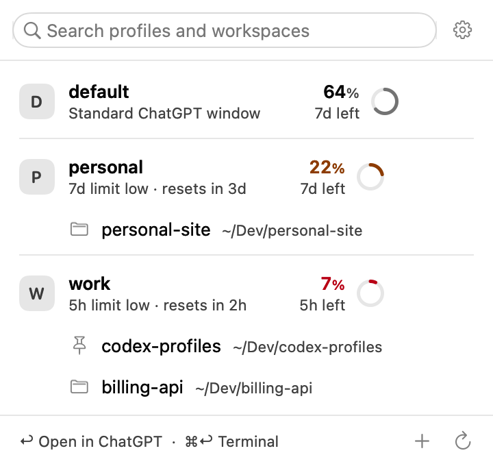
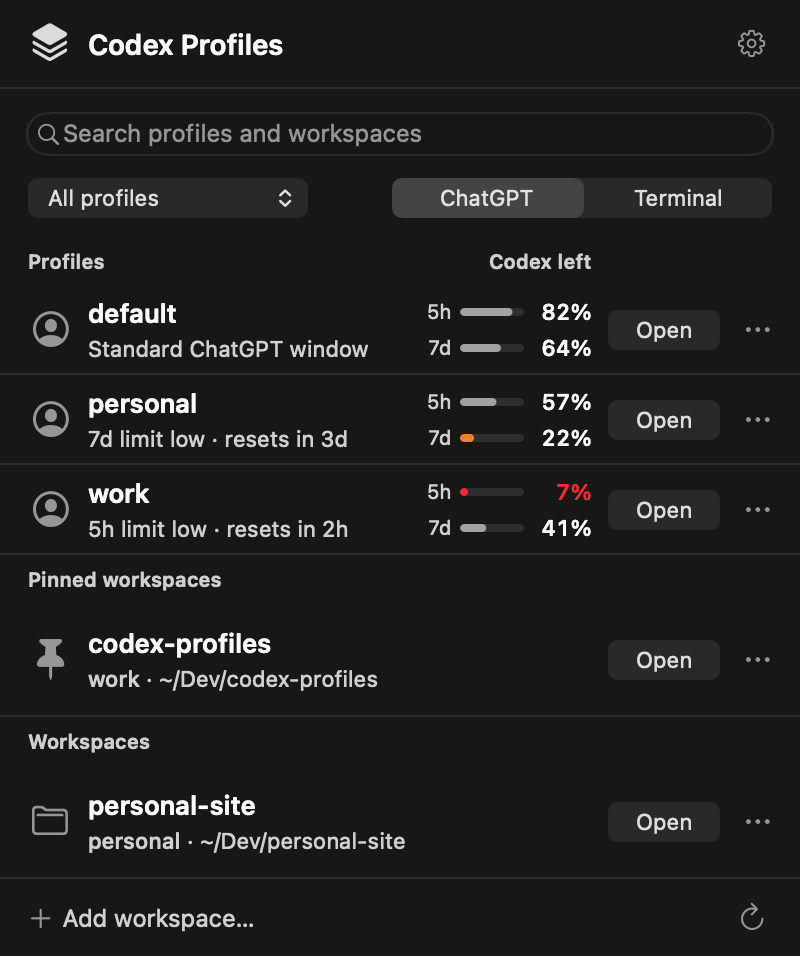
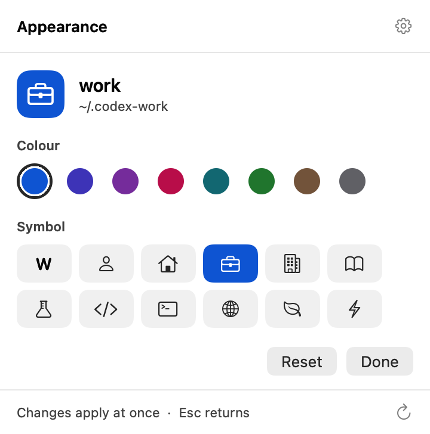

# Codex Profiles for macOS

The native menu-bar companion bundles the existing `codex-profile` engine.
It runs on macOS 13 or newer, on Apple silicon and Intel. It requires neither
Swift nor a separate `codex-profile` installation on the user's Mac.

Drag **Codex Profiles.app** to **Applications**, open it, and click an
existing profile. If none exists, choose **Create profile…**
and enter a name such as `work` or `personal`. A project folder is not required.
The app opens its menu when you launch it. **New profile…** is also in its gear
menu. **Add workspace…** optionally binds a project folder to a profile for a
shortcut. **Open at Login** in the gear menu starts the app quietly in the menu
bar when you log in; macOS may ask you to allow it in Login Items. Opening the
app again from Finder or Spotlight shows the menu.

Open a profile or workspace in **ChatGPT** to use the original installed ChatGPT app.
A named profile opens a window with separate local Desktop state and may
require sign-in inside that window. `default` uses the stock Desktop session.
**Sign In to Codex CLI** in the settings menu starts the official CLI login in
Terminal; it applies only to Codex. The app never reads tokens or cookies and
does not verify that Desktop and CLI use the same account.

ChatGPT launching requires the official desktop app. Terminal launching and
CLI login require the official Codex CLI, either installed separately or
available from the desktop app. Terminal actions may ask for macOS Automation
permission. CLI discovery supports both legacy and current Desktop bundle
layouts, including Finder launches without a separate CLI on PATH.
Local-state separation does not isolate OS credentials or create
a server-side account boundary.

## Menu and keyboard

The menu is a single search field above a list. Each profile leads its own
group and opens without a folder. Its projects sit beneath it on one line
each, with the folder path: pinned projects first, then the rest by their
last successful launch. Projects whose profile is missing follow the groups.
Click a row to open it; its ⋯ actions button appears on hover or selection,
and right-click shows the same actions. Missing folders and profiles show the
reason, keep their actions visible and offer **Locate…** for a moved folder. Refresh
failures preserve loaded content while retaining committed binding changes.
While a binding change is in progress, its row shows **Updating…** and cannot
open, so it never launches the previous profile.

Every row's actions menu offers **Open in ChatGPT** and **Open in Terminal**,
which use that destination once without changing the default. **Return opens
in** in the gear menu sets the default; ChatGPT is the default until you
change it. Profile rows also list each Codex window with its reset time, and
offer **Add workspace…** for that profile, **Appearance…** and **Sign in to
Codex CLI…**.

Each profile has a coloured tile. New profiles get a colour from their name,
with `default` in graphite, and show their initial. **Appearance…** lets you
choose one of eight colours and twelve symbols; changes apply at once and
**Done** or Escape returns to the list. Red, orange and yellow are left out
because they mean low quota. The choice is saved with `codex-profile
appearance`, so the shell prompt, Raycast and new launchers use the same
colour.
Actions that cannot apply, such as revealing a missing folder, are disabled.

Search receives focus when the menu opens. Typing selects the first
available match. ↑/↓ selects available profiles or projects; Return opens the
selection, or the first available row, and ⌘Return opens it in the other
destination, as ⌘-click does. The footer says which destination each key
uses. ⌘1–9 opens the corresponding visible row, ⌘K focuses search, and ⌘R
refreshes. Escape clears search before closing. Successful launches close the
popover.

Profile-only launches start in the home directory. Adding a project shortcut
is a separate action; creating a profile never opens a folder picker unless
you explicitly started **Add workspace…**.

## Codex usage beside each profile

Each profile row shows its tightest reported quota window: the percentage
remaining, the window's duration, such as `5h left`, and a ring filled with
the remaining share. Window labels come from the response: for example, `5h`
and `7d`, or `15m` when that is the actual duration. At 25% or less the ring
and number turn orange, and at 10% or less they turn red; the number always
carries the value. A low window also replaces the row's description with its
reset time, such as `5h limit low · resets in 1h 12m`. The profile's ⋯ menu
lists every window with its remaining share and reset time, and when it was
checked; hover a reading for the same detail. Missing limits show
**Unavailable**; expired readings show a dash until refreshed. Neither state
prevents opening the profile.

Usage belongs to each profile's **Codex CLI** sign-in. Desktop sign-in can
use a different account; the companion does not compare accounts. Sign in
through the profile's actions menu, then press ⌘R. API-key accounts, older
CLIs without this method, offline connections and profiles without CLI sign-in
may not return ChatGPT-backed Codex quota.

The companion uses the official [Codex app-server protocol](https://learn.chatgpt.com/docs/app-server)
through `codex-profile cli <profile> app-server`. It initializes the server,
reads `account/rateLimits/read`, and stops its own subprocess. It prefers the
Codex bucket from `rateLimitsByLimitId`, falling back to the legacy snapshot.
It does not read credential files or send inference requests. Credential
override variables are removed from this query so they cannot substitute an
inherited account for the profile's sign-in.

Reads happen in the background when the menu opens, and about every five
minutes while **Low-quota alerts** is on. They are cached in
memory for 60 seconds, refreshed after a reported reset or with ⌘R, and
limited to two concurrent readers with a ten-second deadline per reader.
During a refresh the previous reading stays visible, dimmed, and each row
updates in place as its reading arrives, keeping hover and keyboard focus.
The query uses a private temporary directory to avoid unrelated workspace
guard bindings. Timeouts, failures, cancellation and Quit stop owned readers;
usage errors do not interrupt profile launches or open error dialogs.

## Low-quota alerts

The menu-bar icon marks low quota on its own. When an initialized profile's
tightest Codex window is at 25% or less, the icon gains a badge dot; at 10%
or less the badge carries an exclamation mark. The icon stays a monochrome
template image, so its shape, not colour, carries the state. Its tooltip and
VoiceOver label name each profile and window, for example
`work: 5h limit at 8%, resets 14:20`. The badge clears when that window's
reset time passes. Quota in a window only falls until it resets, so a reading
stays an upper bound on what is left: the badge never overstates the remaining
quota, but a profile can run lower than it shows until the next reading. The
icon needs no permission and starts no reads of its own.

**Quota in menu bar** in the gear menu shows the lowest remaining percentage
across your profiles beside the icon, such as `7%`, even when nothing is low.
It is off by default. While it is on, the app checks usage about every five
minutes, like alerts, so the figure stays current; it needs no notification
permission and never switches profiles.

**Low-quota alerts** in the gear menu adds macOS notifications. It is off by
default, and macOS asks for notification permission only when you turn it on.
If notifications are not allowed, alerts stay off and the app explains how to
allow them in **System Settings › Notifications**. A permission prompt left
unanswered for two minutes counts as not allowed; allow notifications and
choose the toggle again. If permission is revoked later, or was never granted
to this copy of the app, the menu item shows a mixed state; choose it to turn
alerts off.

A notification announces a crossing into low or critical, not a state that
was already there: the first settled reading after launch, or after turning
alerts on, is the baseline. Readings still refreshing at that moment do not
count. Each profile and window notifies at most once per level per reset
period. A reset period follows the reported reset time, so an early reset
starts a new one, while reset times that differ by seconds do not. A window
without a reported reset time notifies again only after climbing more than
five points above the threshold. The notification names the reset time. When another
profile has at least 50% of the same window left in a reading under 15
minutes old, it also says so, for example `personal has 70% left.` Clicking
the notification opens the menu.

While alerts or **Quota in menu bar** are on, the app checks usage about
every five minutes through the same reader, cache, two-reader limit,
deadlines and process cleanup. Checks stop when both are off or the app
quits, and no reader starts when no profile is initialized. Each check lists
profiles first, so profiles created or removed outside the app join or leave
the checks without opening the menu; it leaves the menu's status line alone.

The app never switches profiles or accounts for you. It shows the numbers
and you choose which profile to open. This is deliberate: Codex Profiles
separates local state and is not a tool for evading rate limits.

## System appearance and accessibility

The running app inherits macOS appearance, including Auto switching between
light and dark mode. Native controls, symbols, dialogs and the popover use
system colours and materials. Custom row decoration resolves colours again
when appearance or accent colours change.

Reduce Motion disables popover animations and updates when the setting changes.
Increase Contrast and Reduce Transparency use opaque system selection fills;
NSPopover handles its own background material. Keyboard selection includes an
outline and an accessibility selected state. Native controls and labelled
actions support keyboard navigation and VoiceOver.

Automated checks cover light → dark → light changes in the same view,
system-colour/accessibility notifications, opaque selection policies, and
keyboard/accessibility state. Alert checks cover the badge shapes at 1x and
2x, crossing and de-duplication rules across jitter, early resets and missing
reset times, the baseline after turning alerts on, headroom choice, the
default-off preference, denied, undecided and unanswered permission, and
background checks following the toggle, using a fake notification center. Actual VoiceOver announcements, OS preference
switching, popover translucency, notification banners and permission prompts
still require a manual check on macOS. Follow [Apple's Dark Mode guidance](https://developer.apple.com/documentation/appkit/supporting-dark-mode-in-your-interface).

These are renders of the actual AppKit view in light and dark appearance,
with sample quota values for layout review.
They use an opaque system backdrop for layout review; live translucency is
provided by NSPopover and depends on macOS appearance and accessibility settings.





See the [design notes](CodexProfilesMenu/DESIGN.md) for Apple guidance and
interaction behaviour. Re-render the previews after changing the view:

```sh
scripts/macos/render-menu-preview.sh macos/CodexProfilesMenu/Previews/menu-light.png
scripts/macos/render-menu-preview.sh macos/CodexProfilesMenu/Previews/menu-dark.png --dark
scripts/macos/render-menu-preview.sh macos/CodexProfilesMenu/Previews/menu-appearance.png --appearance
```

## Build locally

Use a macOS source checkout with the Swift compiler and command-line tools:

```sh
make check
make menu-dmg
```

The builder compiles both architectures, bundles the CLI, license and icon,
and creates a compressed, read-only DMG with an Applications shortcut:

```text
build/macos/Codex Profiles.app
build/macos/Codex-Profiles-1.3.0-universal.dmg
build/macos/Codex-Profiles-1.3.0-universal.dmg.sha256
```

`make menu-app` builds just the app. `MENU_APP_BUILD_DIR` changes the output
directory. Bundle versions are taken from the bundled CLI. The canonical
`make check` discovers the native and DMG tests automatically; native builds
are skipped on hosts without macOS and Swift.

The default build is unsigned and intended for development. It is not a
public release and will not pass the normal Gatekeeper distribution checks.

## Sign and notarise a release

Install your **Developer ID Application** certificate and private key in
Keychain. List available identities with:

```sh
security find-identity -v -p codesigning
```

Store notarisation credentials interactively in Keychain, following
[Apple's notarisation workflow](https://developer.apple.com/documentation/security/customizing-the-notarization-workflow):

```sh
xcrun notarytool store-credentials codex-profiles
```

Then build the distributable with the exact certificate name:

```sh
MENU_APP_SIGNING_IDENTITY='Developer ID Application: Your Name (TEAMID)' \
MENU_APP_NOTARY_PROFILE=codex-profiles make menu-dmg
```

The script signs the companion with hardened runtime and the Apple Events
entitlement needed for Terminal, signs the DMG, submits it to Apple, requires
an **Accepted** result, staples and validates the ticket, and assesses the
DMG with Gatekeeper. It writes the final DMG and checksum only after those
checks pass, and restores the previous pair if publishing them fails.
Notarisation results are retained beside the output for diagnosis.
No credentials are stored in the repository. The original ChatGPT app is
never modified or signed by this builder.

Follow [Apple's distribution testing guidance](https://developer.apple.com/documentation/xcode/packaging-mac-software-for-distribution)
to test a downloaded release on a fresh Mac, including opening from the image
and after moving to Applications. Publishing the resulting files is a separate
maintainer step; the build does not upload them to GitHub.

### Publish a signed download

A public download is deferred until the project has a Developer ID. The
signing and notarisation build above is ready; publishing still needs these
maintainer steps:

1. Enrol in the [Apple Developer Program](https://developer.apple.com/programs/)
   and create a **Developer ID Application** certificate. Install it in
   Keychain and store notarisation credentials as described above.
2. Decide how the DMG reaches the release. GitHub Releases here are
   immutable, and the `Release` workflow publishes each release without
   assets, so a DMG cannot be added to a release after it is published. Either
   change the workflow to create a draft, upload the DMG and `.sha256`, then
   publish; or add a macOS job that signs and notarises in CI, passes both
   files to the release job, and attaches them before the release is
   published. A CI job needs the certificate exported as a password-protected
   `.p12` and an App Store Connect API key for `notarytool`, stored as
   `release` environment secrets.
   Either way, a version that already has a published release cannot gain a
   DMG, so the first download ships with a new version.
3. After a release carries the notarised DMG, add a Homebrew cask beside the
   `codex-profile` formula in
   [Ducksss/homebrew-tap](https://github.com/Ducksss/homebrew-tap), pointing at
   the release asset and its SHA-256.
4. Test the downloaded DMG on a Mac that has never built the app, following
   Apple's distribution testing guidance above, before announcing it.
